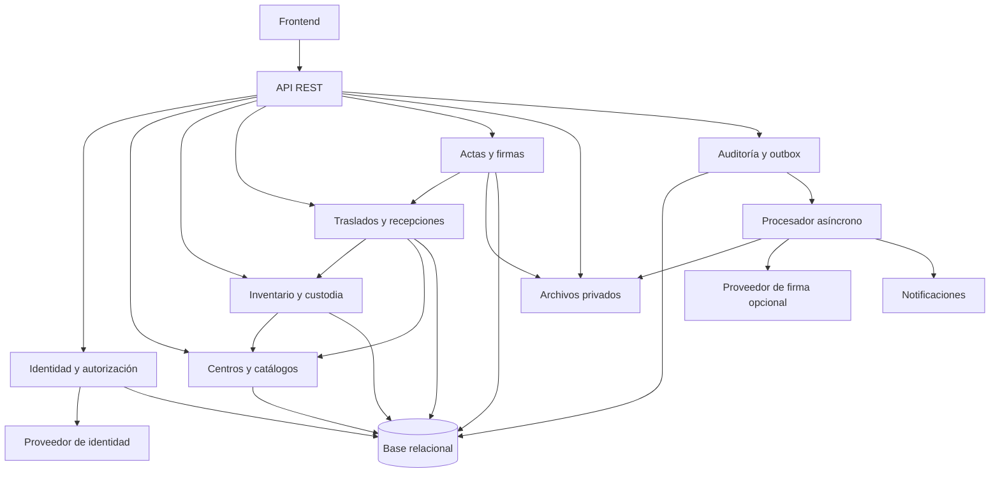

# Sistema de Inventario Tecnológico Multicentro

Especificación técnica — Fase 00 — versión 0.1 — 10 de noviembre de 2026

## 0. Control de requisitos y alcance

Este documento contiene planificación y contratos conceptuales. No contiene una implementación, migraciones ejecutables ni un proyecto ejecutable. No autoriza iniciar la Fase 01.

### 0.1 Evidencia y clasificación

- **A — Aprobado por la solicitud:** sistema de inventario tecnológico multicentro; especificar los doce entregables solicitados; contemplar registro, traslado, recepción parcial, firma y cierre; planificar códigos permanentes y QR; no escribir código ni iniciar Fase 01.
- **P — Propuesta:** toda arquitectura, entidad, regla, permiso, transición, contrato y objetivo cuantitativo de este documento, salvo los requisitos A anteriores. Las reglas P forman una propuesta internamente consistente y verificable, pero no equivalen a aprobación de negocio.
- **D — Decisión pendiente:** pregunta que requiere validación del responsable funcional, de seguridad u operaciones. Se identifica mediante D-xx.

Se revisó la carpeta de trabajo: solo se encontró `.git`, sin archivos de proyecto, `AGENTS.md` local ni documentación versionada en HEAD. No se encontraron instrucciones globales en las ubicaciones superiores consultables; una ubicación superior no permitió lectura. Por ello, no se afirma haber aplicado instrucciones globales ausentes o inaccesibles. Deben suministrarse y reconciliarse antes de aprobar esta especificación (D-01).

### 0.2 Alcance propuesto

Una organización administra múltiples centros, ubicaciones, activos individuales, custodios y responsables. Cada unidad física se identifica individualmente. Se contemplan documentos, evidencias, entregas y discrepancias de recepción. Un lote comercial se descompone en unidades identificables; consumibles, depreciación contable, compras, mantenimiento preventivo y descubrimiento automático quedan pendientes de alcance (D-02), sin introducir módulos obligatorios para ellos.

No se fija proveedor de nube, framework, versión de producto, régimen jurídico de firma ni periodo legal de retención. Las elecciones descritas son funcionales y arquitectónicas, sin afirmar conformidad legal.

### 0.3 Invariantes normativas propuestas

| ID | Invariante |
|---|---|
| INV-01 | Un activo tiene un identificador interno y un código público permanente, únicos e inmutables. Ninguno se reutiliza, incluso tras una baja. |
| INV-02 | Un activo tiene exactamente un centro registral vigente; ubicación física, custodia y tránsito se modelan separadamente. |
| INV-03 | Un activo solo participa en un traslado activo: reservado, autorizado, despachado o pendiente de resolución. |
| INV-04 | El centro registral cambia únicamente al confirmar aceptación en destino. Durante tránsito sigue siendo origen. |
| INV-05 | Un rechazo nunca provoca automáticamente retorno a origen ni disponibilidad. Requiere resolución y evidencia de custodia. |
| INV-06 | Toda mutación relevante verifica identidad, permiso, alcance, versión y transición en backend. |
| INV-07 | Un documento emitido y una firma completada no se sobrescriben. Se conservan versiones, huellas y eventos de corrección. |
| INV-08 | No se cierra un traslado mientras exista un ítem o discrepancia sin resolución, un acta requerida sin formalizar o una firma requerida incompleta. |
| INV-09 | Estado de negocio, auditoría y evento de salida se guardan atómicamente. Los efectos externos se reintentan sin duplicar operaciones. |
| INV-10 | El QR no es una credencial ni permite consultar información sensible sin autorización. |

## 1. Arquitectura propuesta [P]

### 1.1 Componentes

| Capa | Responsabilidad y límites |
|---|---|
| Frontend web adaptable | Inventario, búsqueda, lectura de QR, formularios, bandejas por rol y centro, recepción por ítem, visualización de documentos y estado de firmas. Navegación accesible por teclado; mensajes de error asociados a campos. No decide autorizaciones. |
| Backend REST | Monolito modular inicialmente: dominio, autorización, transacciones, consulta e integraciones. API versionada. Evita la complejidad operativa inicial de microservicios. |
| Identidad | Proveedor corporativo con OpenID Connect; flujo de autorización con PKCE y sesión web mediante backend intermediario. Sesión en cookie Secure, HttpOnly y política SameSite compatible con el flujo elegido. MFA para funciones privilegiadas y firma interna. |
| Base relacional | PostgreSQL como propuesta; integridad referencial, restricciones únicas, transacciones y bloqueo de filas para reservas y recepciones. Esquema con `organization_id` y alcance explícito por centro. |
| Almacenamiento de objetos | Contenedores privados para cuarentena, evidencias y documentos; cifrado, versionado y acceso temporal controlado. Los archivos no se guardan como binarios en tablas de negocio. |
| Procesador asíncrono | Analiza adjuntos, genera PDF/QR, envía notificaciones y coordina firmas externas. Consume una bandeja transaccional de eventos; reintentos y cola de fallos visibles. |
| Operación | Registros estructurados, métricas, trazas correlacionadas, gestión de secretos, copias de respaldo y restauraciones comprobadas. |

Frontend y backend web se sirven bajo un origen controlado, con protección CSRF para comandos autenticados por cookie. Las integraciones máquina a máquina usan credenciales independientes y permisos limitados. Los tokens del proveedor no se almacenan en almacenamiento local del navegador.

El alcance inicial es una organización con múltiples centros; `organization_id` es defensa de aislamiento y no implica un producto SaaS multicliente aprobado (D-03). No se habilita escritura sin conexión: los conflictos físicos requieren confirmación en línea. La consulta móvil y escaneo QR sí forman parte de la propuesta.

### 1.2 Límites transaccionales

Reserva de activos, autorización, despacho, confirmación de cada recepción, resolución y cierre se ejecutan en transacciones locales. Se bloquean filas de activo/reserva y se verifica su versión. No se mantiene una transacción abierta mientras se consulta identidad, firma externa, antivirus o almacenamiento.

La base guarda el evento en una tabla outbox dentro de la transacción de negocio. El procesador entrega al menos una vez; consumidores deduplican por ID de evento. La interfaz distingue operación confirmada de generación documental pendiente. Una generación fallida nunca simula un acta emitida.

## 2. Módulos y dependencias [P]

Los módulos exponen servicios internos definidos y no escriben directamente las tablas de otro módulo. Traslados orquesta inventario; actas consulta una instantánea del movimiento. El módulo de movimientos consulta la condición documental a través de un contrato de lectura para cerrar, sin delegar en documentos la mutación del movimiento. Auditoría y outbox son infraestructura transversal. Una notificación no modifica estados de negocio.

## 3. Modelo de dominio [P]

| Entidad | Atributos principales y relaciones |
|---|---|
| Organización | ID, nombre, configuración, zona horaria de presentación. |
| Centro | Organización, código único, nombre, estado activo/inactivo. No se elimina si tiene historial. |
| Ubicación | Centro, nombre, tipo y ubicación superior opcional. Padre e hijo deben pertenecer al mismo centro; sin ciclos. |
| Usuario | ID interno, sujeto estable y emisor del proveedor de identidad; nombre y estado. El correo no es clave de identidad. |
| Asignación de rol | Usuario, rol, alcance global o conjunto de centros, vigencia y autor del cambio. |
| Persona/custodio | Identificador, nombre, vínculo con centro y referencia opcional a usuario. No todo custodio necesita cuenta. |
| Activo | ID, código permanente, categoría, marca, modelo, serie normalizada opcional, centro registral, ubicación actual, condición física, estado operativo, versión. |
| Asignación de custodia | Activo, persona/responsable, inicio, fin, causa y movimiento relacionado. Una sola asignación abierta por activo cuando corresponda. |
| Evento de activo | Activo, tipo, fecha, actor, origen, destino, motivo y referencias documentales. Historial inmutable. |
| Traslado | Número legible, origen, destino distintos, solicitante, autorizador, transportista/receptor de custodia, estado, versión y fechas. |
| Ítem de traslado | Traslado, activo único dentro del traslado, instantánea al despacho, resultado de recepción, resolución y reserva asociada. |
| Reserva | Activo, traslado, fecha de activación/liberación; exclusión de más de una reserva activa por activo. |
| Recepción | Traslado, receptor, fecha y estado; contiene uno o más ítems y sus evidencias. Puede haber múltiples recepciones por traslado. |
| Ítem de recepción | Ítem de traslado, resultado aceptado o rechazado, condición observada, ubicación/custodio destino si aceptado, motivo si rechazado. Un resultado confirmado por ítem; correcciones mediante resolución vinculada. |
| Discrepancia | Ítem, tipo: daño, rechazo, faltante u otro; responsable, evidencias, estado y resolución autorizada. |
| Resolución | Discrepancia, tipo de solución, aprobador, ejecución, evidencia y destino de custodia. No borra recepción original. |
| Acta | Tipo, entidad origen, versión, instantánea de datos, hash del contenido, archivo, estado y relación con versión sustituida. |
| Solicitud de firma | Acta y hash exactos, política/orden de firmantes congelados, vencimiento, estado, proveedor opcional. |
| Firma | Solicitud, firmante esperado y real, método, resultado, fecha, evidencia y referencia externa. |
| Archivo | Clave opaca, organización, propietario lógico, tamaño, tipo validado, hash, estado de análisis, clasificación y retención. |
| Evento de auditoría | Actor efectivo/original, acción, entidad, centro, resultado, fecha UTC, correlación, motivo y cambios redactados. |
| Outbox / idempotencia | Evento o comando, clave, ámbito, huella de petición, resultado y estado de entrega. |

Relaciones: organización 1:N centros; centro 1:N ubicaciones; activo 1:N custodias/eventos; traslado 1:N ítems y 1:N recepciones; ítem 1:N discrepancias, con un único resultado de recepción confirmado; acta 1:N solicitudes históricas de firma, sin solicitudes activas concurrentes para el mismo propósito; solicitud 1:N firmas.

Las series no son identificadores permanentes. Se propone advertir posibles duplicados por fabricante y serie normalizada, con excepción justificada y auditada; la restricción definitiva queda en D-04. Se prohíbe eliminación física de activos y movimientos con historial. La condición física no sustituye al estado operativo.

## 4. Roles, permisos y alcances [P]

Leyenda: G = toda la organización; C = centros asignados; O = centro origen asignado; D = centro destino asignado; S = solo solicitudes/documentos propios o asignados; — = sin permiso.

| Acción | Admin. seguridad | Gestor global | Gestor centro | Operador origen | Receptor | Firmante | Auditor |
|---|---|---|---|---|---|---|---|
| Administrar usuarios/roles | G | — | — | — | — | — | lectura G |
| Administrar centros/catálogos | — | G | lectura C | lectura C | lectura C | — | lectura G |
| Consultar inventario | — | G | C | C | C | S mínimo | G |
| Registrar/editar activos disponibles | — | G | C | C | — | — | — |
| Crear/editar traslado borrador | — | G | O | O | — | — | — |
| Autorizar traslado | — | G | O | — | — | — | — |
| Despachar | — | G | O | O | — | — | — |
| Confirmar recepción | — | G | D | — | D | — | — |
| Resolver discrepancia | — | G | C* | — | proponer D | — | — |
| Firmar | — | S | S | S | S | S | — |
| Emitir acta/cerrar | — | G | C* | — | — | — | — |
| Proponer/aprobar baja | — | G | C* | proponer C | — | — | — |
| Consultar auditoría/exportar | seguridad G | G | C | — | — | — | G |

`C*`: requiere alcance sobre ambos centros o aprobaciones independientes de origen y destino, conforme a política pendiente D-05. La propuesta inicial exige aprobación global para resolución de discrepancias y cierre cuando el gestor solo tiene un centro.

Reglas adicionales:

- Denegar por defecto. Los roles se suman, pero las restricciones de separación de funciones prevalecen.
- El solicitante no autoriza su propio traslado; quien despacha no confirma su recepción. Quien propone una baja no la aprueba. No se admite autoasignación de privilegios.
- Solo el firmante asignado puede firmar; un gestor no suplanta su identidad. Las delegaciones requieren reemplazo explícito antes de firmar y registro de motivo.
- Origen y destino pueden consultar el traslado compartido y sus documentos mínimos aunque no tengan acceso al inventario completo del otro centro.
- Firmante recibe acceso limitado a la instantánea que debe firmar. Auditor es de solo lectura y no recibe permisos de firma.
- Revocar un alcance invalida nuevas acciones y descargas; no altera registros históricos.
- Cualquier acceso extraordinario exige política explícita, motivo y auditoría; no se presupone un bypass de administrador.

## 5. Máquinas de estados [P]

### 5.1 Activos

| Desde | Acción/condición | Hacia | Efecto |
|---|---|---|---|
| INEXISTENTE | Registrar con datos válidos | DISPONIBLE | Asigna código y centro; alta auditada. |
| DISPONIBLE | Asignar custodio | ASIGNADO | Abre custodia. |
| ASIGNADO | Devolver con evidencia | DISPONIBLE | Cierra custodia. |
| DISPONIBLE o ASIGNADO | Enviar traslado a autorización | RESERVADO | Guarda estado previo y crea reserva exclusiva. |
| RESERVADO | Rechazar/cancelar antes de despacho | Estado previo | Libera reserva. |
| RESERVADO | Despachar traslado autorizado | EN_TRANSITO | Registra custodia de transporte; cierra custodia previa. |
| EN_TRANSITO | Aceptación confirmada | DISPONIBLE o ASIGNADO | Cambia centro y ubicación; abre custodia destino si procede; libera reserva. |
| EN_TRANSITO | Rechazo o faltante declarado | EN_INCIDENCIA | Centro registral sigue siendo origen; custodia física registrada explícitamente. |
| EN_INCIDENCIA | Resolver y ejecutar devolución | DISPONIBLE o ASIGNADO en origen | Exige recepción de devolución y evidencia. |
| EN_INCIDENCIA | Resolver y aceptar en destino | DISPONIBLE o ASIGNADO en destino | Exige aceptación explícita de destino. |
| DISPONIBLE o ASIGNADO | Aprobar baja documentada | BAJA | Cierra custodia; conserva código e historial. |
| EN_INCIDENCIA | Resolver pérdida y aprobar baja | BAJA | Resolución y acta de pérdida; conserva centro registral histórico. |

BAJA es terminal en esta propuesta. Correcciones patrimoniales se especificarán antes de habilitar reversión (D-06). No se permite editar centro directamente ni dar de baja un activo reservado/en tránsito. Ubicación física puede ser destino aun con centro registral origen cuando hubo rechazo; debe mostrarse esa diferencia.

### 5.2 Traslados

BORRADOR → PENDIENTE_AUTORIZACION → AUTORIZADO → EN_TRANSITO → RECIBIDO_PARCIAL o RECIBIDO_TOTAL → PENDIENTE_CIERRE → CERRADO.

Ramas y guardas:

- BORRADOR → CANCELADO por solicitante autorizado. No reserva activos.
- Enviar a PENDIENTE_AUTORIZACION valida todos los activos y reserva el conjunto atómicamente; falla completo si uno no está disponible para traslado.
- PENDIENTE_AUTORIZACION → RECHAZADO por autorizador distinto del solicitante; libera reservas. La reanudación se hace mediante nuevo borrador vinculado.
- PENDIENTE_AUTORIZACION o AUTORIZADO → CANCELADO antes de despacho, con motivo y liberación de reservas.
- AUTORIZADO → EN_TRANSITO exige acta de despacho formalizada según la política de firmas, todos los ítems reservados y custodia de transporte identificada. No se propone despacho parcial: requiere separar traslados antes de autorizar.
- Tras una recepción, RECIBIDO_PARCIAL significa que al menos un ítem tiene resultado y otro sigue sin resultado. RECIBIDO_TOTAL significa que todos tienen resultado de recepción; no significa que todos fueron aceptados.
- Cualquier discrepancia abierta produce EN_DISCREPANCIA. Este estado tiene prioridad de presentación; los contadores de recibidos/pendientes se mantienen independientemente.
- Cuando se resuelven discrepancias, el estado vuelve a EN_TRANSITO/RECIBIDO_PARCIAL/RECIBIDO_TOTAL según los resultados existentes.
- PENDIENTE_CIERRE exige todos los ítems terminales: aceptado en destino, devuelto y recibido en origen o baja por pérdida aprobada. Exige cero discrepancias abiertas.
- CERRADO exige acta final formalizada y firmas requeridas completas. Es terminal. Después del despacho no se cancela: se documenta devolución o resolución.

### 5.3 Recepciones

BORRADOR → CONFIRMADA; BORRADOR → DESCARTADA. CONFIRMADA y DESCARTADA son terminales.

Una recepción confirmada es inmutable. Cada ítem confirmado pasa de PENDIENTE a ACEPTADO o RECHAZADO. Los faltantes se registran como discrepancias de ítems aún pendientes; no se marcan como físicamente recibidos. Una resolución posterior puede producir ACEPTADO_POR_RESOLUCION, DEVUELTO_ORIGEN o BAJA_POR_PERDIDA. Cada resultado identifica actor y evidencia.

Confirmar una recepción aplica todos sus ítems en una única transacción. Para aceptar solo parte de lo inspeccionado, el usuario crea una recepción con ese subconjunto. Un conflicto en un ítem invalida esa confirmación completa y conserva el borrador.

### 5.4 Firmas

CREADA → PENDIENTE → FIRMADA, RECHAZADA, VENCIDA o CANCELADA. Los estados finales no se reabren.

Una solicitud está COMPLETA cuando todos los firmantes requeridos han firmado el mismo contenido, con el orden establecido si aplica. Un rechazo, vencimiento o cancelación deja la solicitud NO_COMPLETADA; puede emitirse una nueva solicitud sobre el mismo contenido si sigue vigente. No se aceptan firmas nuevas de solicitudes reemplazadas o vencidas.

FIRMADA exige autenticación suficiente, coincidencia de firmante, manifestación de voluntad, hash esperado y evidencia persistida. Una imagen de rúbrica aislada no satisface este requisito. El método interno de aprobación autenticada y la firma electrónica con proveedor son alternativas pendientes de D-07; no se equiparan automáticamente en efectos legales.

### 5.5 Actas

BORRADOR → EMITIDA → EN_FIRMA → FORMALIZADA.

- BORRADOR puede descartarse; EMITIDA congela instantánea y archivo verificado.
- Si la política aprobada no requiere firmas, EMITIDA → FORMALIZADA por control del sistema. Esa exención no está aprobada actualmente.
- EMITIDA/EN_FIRMA → ANULADA con motivo cuando hay error o se invalida el acto antes de formalizar.
- FORMALIZADA → SUSTITUIDA solo al formalizar una versión correctiva vinculada, con firmas nuevas y autorización pertinente. El original permanece accesible.
- Una firma rechazada o vencida conserva el acta EN_FIRMA con solicitud no completada; una nueva solicitud requiere acción explícita.
- Una corrección documental nunca revierte por sí sola el inventario. Si el hecho físico cambia, requiere una resolución o movimiento compensatorio autorizado.

Para evitar circularidad, las actas se generan con instantáneas de hechos ya confirmados o de un compromiso de despacho autorizado. La formalización habilita el paso posterior; no necesita que ese paso ya haya ocurrido.

## 6. Flujos completos [P]

### 6.1 Registro

1. Usuario con permiso y alcance elige centro y ubicación, registra categoría, descripción, serie si existe, condición y evidencia opcional.
2. Backend valida campos, centro activo, ubicación perteneciente al centro y posibles duplicados; una evidencia obligatoria debe estar analizada como limpia.
3. Transacción crea activo DISPONIBLE, código permanente, evento y auditoría. Un reintento con la misma clave devuelve el mismo resultado.
4. Se genera etiqueta QR; un fallo de impresión no revierte el registro. La reimpresión conserva código y deja auditoría.
5. Si hay custodio, se realiza asignación explícita y se registra su aceptación según política D-08.

### 6.2 Solicitud, autorización y despacho

1. Origen crea borrador con destino activo distinto, motivo, activos y responsable de transporte.
2. Al enviar se comprueban permisos, centro vigente y estados; se reservan todos los activos. El usuario ve las custodias que se cerrarán al despachar.
3. Un autorizador independiente aprueba o rechaza. Cambiar activos, origen o destino exige volver a borrador mediante cancelación y nueva solicitud vinculada; no altera una autorización vigente.
4. Se emite acta de despacho con lista e instantáneas, custodio de transporte y firmantes requeridos. Se completan firmas antes del despacho físico según propuesta inicial.
5. Origen confirma entrega física. En una transacción el traslado pasa EN_TRANSITO y los activos se actualizan conforme a INV-04. Se notifica a destino con entrega asíncrona.

### 6.3 Recepción parcial y discrepancias

1. Receptor de destino abre el traslado y escanea códigos; el sistema impide agregar activos ajenos o ya resueltos.
2. Selecciona únicamente los ítems recibidos, registra condición, ubicación y custodio para aceptados; registra motivo/evidencias para rechazados.
3. Confirma una recepción atómica. Aceptados cambian de centro y liberan reserva; rechazados quedan en incidencia con custodia física explícita y mantienen reserva. Los no recibidos continúan en tránsito.
4. Se genera acta de recepción parcial y se solicita su firma. La confirmación física permanece registrada aunque una firma documental esté pendiente; el cierre queda bloqueado.
5. Se repite para nuevas entregas. No hay aceptación automática por plazo. Un vencimiento operativo genera alerta y permite declarar faltante con evidencia.
6. Gestor autorizado resuelve rechazos/faltantes: aceptación subsanada, devolución documentada y recibida en origen o pérdida con baja aprobada. Una devolución se registra como ejecución de resolución vinculada al ítem original, sin crear otra reserva concurrente.

### 6.4 Firma y cierre

1. El firmante consulta el PDF exacto, su versión y finalidad. El sistema registra hash y consentimiento.
2. Firma interna o proveedor externo verifica identidad y devuelve resultado correlacionado; callbacks duplicados son inocuos. Fallos temporales dejan estado pendiente, sin presumir firma.
3. Completadas las firmas, el acta queda FORMALIZADA; se conservan original, versión firmada y evidencia de su relación.
4. Cuando todos los ítems y discrepancias están resueltos, el traslado pasa PENDIENTE_CIERRE. Se genera acta final con el resumen de aceptaciones, devoluciones, pérdidas y actas previas.
5. Completadas las firmas del acta final, un comando explícito revalida invariantes y cierra el traslado atómicamente. Una firma tardía sobre otra versión no habilita el cierre.
6. Se notifica resultado. Las correcciones futuras son nuevos eventos o documentos vinculados y no reescriben el cierre original.

## 7. Códigos permanentes y QR [P]

- ID interno: UUID opaco, generado en servidor. No incorpora ubicación, condición ni identidad personal.
- Código visible propuesto: `ATI-000000000001-CC`; doce dígitos secuenciales organizacionales y dos dígitos verificadores calculados como 98 menos el resto de dividir el número multiplicado por 100 para 97. Se preservan ceros iniciales. Capacidad y prefijo requieren D-09.
- La secuencia se asigna transaccionalmente; se aceptan huecos y se prohíbe reutilización. No cambia con traslado, cambio de nombre o baja. El dígito verificador detecta errores de ingreso; no autentica el activo.
- QR: URL HTTPS estable bajo dominio institucional, ruta `/q/{identificador-publico-opaco}`. El identificador es aleatorio de al menos 128 bits, único y distinto del ID interno; resolverlo exige sesión y alcance.
- La URL conduce a una ficha autorizada o a inicio de sesión; la redirección de retorno admite únicamente rutas internas. Respuesta no autorizada no revela existencia, centro, serie ni custodio.
- Etiqueta incluye código legible y QR, sin datos personales. Se documentan dimensiones, resistencia y contraste tras prueba física D-09.
- Una etiqueta dañada se reimprime; se conserva el código. Si se compromete el identificador QR se puede rotar, con auditoría, manteniendo el código permanente.
- Cambio de dominio requiere redirecciones institucionales mantenidas. Un QR sin conexión solo permite leer la URL/código, sin modificar inventario.

## 8. Almacenamiento y protección de archivos [P]

1. API autoriza intención de carga y crea registro SUBIDA_PENDIENTE. Clave de objeto aleatoria; el nombre original solo es metadato saneado.
2. Carga temporal a cuarentena mediante autorización limitada a objeto, tamaño y plazo. Máximo inicial propuesto: 20 MiB por archivo; PDF, JPEG y PNG. Otros formatos requieren evaluación.
3. Finalización verifica existencia, tamaño real, firma del formato, hash SHA-256 y análisis antimalware. No se confía en extensión o tipo enviado por cliente. Se limitan recursos del analizador y se rechazan archivos cifrados no inspeccionables.
4. Estados: SUBIDA_PENDIENTE → CUARENTENA → LIMPIO o RECHAZADO; errores de análisis permanecen bloqueados. Solo LIMPIO puede adjuntarse como evidencia válida o descargarse por usuarios normales.
5. Descarga vuelve a comprobar organización, centro y relación documental; preferencia por proxy autenticado para material sensible. Si se usa URL temporal, vigencia máxima propuesta de 60 segundos y aceptación explícita de su ventana residual de revocación.
6. Cifrado en tránsito y reposo, claves gestionadas fuera de la base, permisos mínimos y registros de acceso. Sin contenedores públicos ni datos sensibles en claves o enlaces.
7. Actas emitidas y evidencias firmadas usan versionado e inmutabilidad compatible con la retención aprobada. Las firmas producen nuevos objetos, nunca sobrescritura del original.
8. Limpieza de cargas huérfanas tras 24 horas, con comprobación de referencias; retención de cuarentena rechazada propuesta de 7 días. Plazos sujetos a D-10.

La política de retención debe diferenciar evidencias, actas, auditoría, copias y datos personales. Un bloqueo de conservación impide purga. La eliminación autorizada registra quién, motivo y prueba de ejecución; los datos aún presentes en respaldos caducan con su ciclo documentado.

## 9. Contratos REST preliminares [P]

Base lógica `/api/v1`. JSON UTF-8; fechas ISO 8601 UTC; presentación en zona del centro, inicialmente America/Guayaquil pendiente de confirmación. IDs opacos. Listados con cursor, límite por defecto 50 y máximo 200, orden estable por campo e ID. Filtros por centro, estado, categoría y texto se combinan con el alcance autorizado. Exportaciones extensas son trabajos asíncronos y vuelven a verificar permisos al descargar.

### 9.1 Convenciones

- Creación: 201 y cabecera Location. Lectura/comando confirmado: 200; operación asíncrona: 202 y recurso de seguimiento. Sesión inválida: 401; permiso insuficiente: 403 o 404 uniforme para recursos fuera de alcance; formato: 400; validación: 422; conflicto de estado o reserva: 409.
- Recursos mutables devuelven ETag. Comandos y modificaciones requieren If-Match; falta: 428, versión obsoleta: 412. Nuevas entidades no requieren versión previa.
- POST de creación y comandos requieren Idempotency-Key, vinculada a actor, organización y operación. Misma clave/cuerpo devuelve mismo resultado; distinto cuerpo: 409. Retención inicial: siete días; además, restricciones de dominio evitan duplicados tras expirar la clave. Altas externas pueden usar referencia de importación única.
- Errores Problem Details con `type`, `title`, `status`, `detail` saneado, `instance`, `code`, `correlation_id` y errores de campos. Ejemplos: `ASSET_RESERVED`, `CENTER_SCOPE_DENIED`, `INVALID_TRANSITION`, `PENDING_SIGNATURES`.
- No se acepta establecer estados o centro de activo mediante PATCH genérico. No hay DELETE de historial. Campos derivados y protegidos se rechazan si el cliente intenta escribirlos.

### 9.2 Recursos y comandos

| Método y ruta | Entrada esencial | Resultado y guardas |
|---|---|---|
| GET `/me` | Sesión | Identidad, roles y alcances vigentes; datos mínimos. |
| GET/POST `/centers` | Filtros / código y nombre | Lista autorizada / centro creado por gestor global. |
| POST `/centers/{id}/locations` | Nombre, padre opcional | Ubicación del mismo centro, sin ciclos. |
| GET `/assets` | Centro, estado, búsqueda, cursor | Lista limitada por alcance. |
| POST `/assets` | Centro, ubicación, categoría, descripción, serie opcional | Activo y código permanente; duplicados conforme a política. |
| GET `/assets/{id}` | ID | Ficha, versión y acciones permitidas. |
| PATCH `/assets/{id}` | Solo atributos descriptivos permitidos | Actualización auditada; sin alterar estado/centro/código. |
| GET `/assets/{id}/events` | Cursor | Historial autorizado. |
| POST `/assets/{id}/custody-assignments` | Persona, fecha efectiva, motivo | Asignación solo en estado permitido; fechas retroactivas sujetas a D-08. |
| POST `/assets/{id}/custody-returns` | Asignación vigente, evidencia | Cierre de custodia y disponibilidad. |
| POST `/assets/{id}/retirement-requests` | Motivo y evidencia | Solicitud de baja con aprobador independiente. |
| POST `/retirement-requests/{id}/approve` | Motivo, acta formalizada | Baja si no existe reserva/tránsito. |
| GET `/q/{publicId}` | Sesión | Resuelve activo autorizado; ruta web externa al prefijo API. |
| POST `/assets/{id}/label-requests` | Formato permitido, motivo | Etiqueta o trabajo de generación; sin cambiar código. |
| GET/POST `/transfers` | Filtros / origen, destino, motivo, IDs de activos | Lista compartida autorizada / borrador. |
| PATCH `/transfers/{id}` | Datos e ítems completos del borrador | Solo BORRADOR; versión requerida. |
| GET `/transfers/{id}` | ID | Estado, contadores, ítems, versión y bloqueos de cierre. |
| POST `/transfers/{id}/submit` | Referencia a versión | Reserva atómica y PENDIENTE_AUTORIZACION. |
| POST `/transfers/{id}/authorize` | Decisión aprobar/rechazar, motivo | Separación de funciones y permisos de origen. |
| POST `/transfers/{id}/cancel` | Motivo | Solo antes de despacho; libera reservas. |
| POST `/transfers/{id}/dispatch` | Custodio transporte, acta de despacho | Acta formalizada y reservas válidas; EN_TRANSITO. |
| POST `/transfers/{id}/receipts` | Ítems, resultados, ubicación/custodio, evidencia | Recepción BORRADOR. |
| PATCH `/receipts/{id}` | Ítems del borrador | Solo BORRADOR. |
| POST `/receipts/{id}/confirm` | Versión, fecha observada | Confirma conjunto atómicamente; backend fija fecha de registro. |
| POST `/receipts/{id}/discard` | Motivo | Descarta borrador sin afectar inventario. |
| POST `/transfers/{id}/discrepancies` | Ítem, tipo, motivo, evidencias | Incidencia autorizada; faltante no implica recepción. |
| POST `/discrepancies/{id}/resolutions` | Tipo, responsables, evidencias | Resolución propuesta; no cierra incidencia todavía. |
| POST `/resolutions/{id}/approve` | Motivo | Aprobación independiente y alcance suficiente. |
| POST `/resolutions/{id}/execute` | Evidencia de aceptación/devolución/baja | Cambia activo y resuelve ítem según tipo aprobado. |
| POST `/acts` | Tipo, entidad origen, versión fuente | Borrador/operación asíncrona; no admite PDF arbitrario como acta generada. |
| POST `/acts/{id}/issue` | Versión validada | Congela contenido y archivo limpio; EMITIDA. |
| GET `/acts/{id}` | ID | Metadatos, hash, versión, firmas y estado. |
| POST `/acts/{id}/signature-requests` | Política aprobada y firmantes | Solicitud sobre contenido emitido; sin política libre desde cliente. |
| POST `/signature-requests/{id}/sign` | Hash, consentimiento y comprobación de identidad | Firma interna si está habilitada; firma externa devuelve sesión del proveedor. |
| POST `/signature-requests/{id}/reject` | Motivo | Rechazo por firmante asignado. |
| POST `/signature-requests/{id}/cancel` | Motivo | Cancela solicitud pendiente por gestor autorizado. |
| POST `/acts/{id}/corrections` | Motivo y datos corregidos | Nueva versión vinculada; conserva original. |
| POST `/acts/{id}/annul` | Motivo | Solo en estados permitidos; preserva evidencia. |
| POST `/transfers/{id}/close` | Acta final y versión | Revalida INV-08 y cierra. |
| POST `/files/upload-intents` | Propósito, tamaño, tipo, entidad relacionada | Registro y autorización de cuarentena. |
| POST `/files/{id}/complete` | Referencia de carga | Verifica objeto e inicia análisis; 202. |
| GET `/files/{id}` | ID | Estado del análisis y metadatos autorizados. |
| POST `/files/{id}/download-authorizations` | Finalidad | Acceso temporal o proxy si LIMPIO y autorizado. |
| GET `/audit-events` | Centro, entidad, intervalo, cursor | Eventos dentro del alcance del auditor. |
| GET `/jobs/{id}` | ID | Estado y resultado autorizado de trabajo asíncrono. |
| POST `/integrations/signatures/events` | ID de evento, referencia, resultado firmado | Autenticación de proveedor, antirrepetición y deduplicación; sin sesión de usuario. |

Datos mínimos de una confirmación de recepción: ID y versión de recepción, ítems con `transfer_item_id`, `outcome`, condición y evidencia; para aceptados, `destination_location_id` y custodio cuando lo exija la política. La respuesta incluye nueva versión del traslado, resultados por ítem y actas pendientes. El cliente no envía el centro registral resultante: lo deriva el dominio.

Las rutas administrativas de roles y revocación deben especificarse en el contrato detallado antes de implementar identidad; no se permiten cambios directos en base como procedimiento ordinario.

## 10. Requisitos no funcionales [P]

### 10.1 Seguridad

- Autorización por recurso y centro en cada consulta, comando, exportación, descarga y trabajo asíncrono. Pruebas de acceso por ID ajeno y centro ajeno obligatorias.
- MFA en privilegios y firma; expiración por inactividad propuesta de 30 minutos y duración máxima de 8 horas; reautenticación para firma si la autenticación tiene más de 5 minutos. Revocación efectiva de acciones nuevas en hasta 5 minutos, objetivo pendiente de aprobación.
- TLS en todos los enlaces externos; secretos fuera del repositorio y registros; rotación documentada. Consultas parametrizadas, límites de payload, escape de salida y política de seguridad de contenido.
- Protección CSRF, rate limiting por identidad/IP ajustable y protección de callbacks con verificación criptográfica, ventana temporal y deduplicación. No confiar en estados enviados por navegador.
- Validación de dependencias y configuración antes de liberar; corrección de vulnerabilidades críticas explotables antes de producción. Pruebas de permisos al ejecutar y al entregar exportaciones.
- Datos personales mínimos; exportaciones registradas; sin tokens, cookies, documentos completos ni datos personales innecesarios en logs.

### 10.2 Auditoría

Registrar altas, modificaciones, autorizaciones denegadas relevantes, cambios de rol, reservas, movimientos, recepciones, firmas, descargas sensibles, exportaciones, cierres y operaciones administrativas. Cada evento contiene actor, contexto de alcance, hora del servidor, entidad, acción, resultado, correlación y motivo cuando proceda.

Auditoría de cambios confirmados se escribe en la misma transacción. Si falla, la mutación falla. Los intentos denegados se registran por canal de seguridad, sin intentar confirmar una transacción rechazada. Tablas de auditoría sin actualización/eliminación para la cuenta de aplicación; copia periódica a almacenamiento inmutable bajo credenciales separadas. La resistencia a administradores de infraestructura requiere separación de funciones, no se presume por usar una tabla append-only.

### 10.3 Rendimiento y disponibilidad

Perfil de validación inicial propuesto: 100 centros, 100.000 activos, 1 millón de eventos históricos, 200 sesiones concurrentes y 30 solicitudes por segundo sostenidas. Traslado máximo inicial: 200 activos; recepción máxima: 200 ítems. Los límites evitan transacciones sin cota; mayores volúmenes requieren rediseño y prueba.

Objetivos medidos en entorno comparable a producción durante 30 minutos, con base precargada y mezcla representativa: p95 de consulta paginada ≤ 1 s y comando síncrono ≤ 2 s desde entrada a API hasta respuesta; errores inesperados < 0,5 %. No incluyen proveedor externo, transferencia de archivos ni generación de PDF. Acta de hasta 200 activos: p95 ≤ 60 s desde encolado hasta archivo disponible con cinco trabajos simultáneos. Una búsqueda respeta el alcance antes de paginar; jamás pagina globalmente para filtrar después.

Disponibilidad mensual propuesta: 99,5 %, definiendo ventana y exclusiones con operaciones antes de aprobar. Alertas por errores, latencia, retraso outbox > 5 minutos, firmas atascadas, análisis fallidos y almacenamiento/base próximos a capacidad. Índices por organización, centro, estado, código y relaciones; no se incorpora un motor de búsqueda externo sin evidencia de necesidad.

### 10.4 Respaldo y recuperación

- Objetivos propuestos: RPO ≤ 15 minutos y RTO ≤ 4 horas para base, documentos y evidencias necesarios para operar.
- Copia base diaria y registro continuo para recuperación puntual; almacenamiento de objetos versionado y replicado o copiado dentro del RPO objetivo. Copias cifradas en dominio de fallo y credenciales separados.
- Retención operativa inicial de respaldos: 35 días, pendiente de D-10; no sustituye retención documental.
- Restauración trimestral a entorno aislado: verificar entidades, referencias a objetos, hashes de actas, firmas, reservas, auditoría y consistencia del outbox. Medir RPO/RTO reales.
- Tras restauración, pausar integraciones salientes hasta reconciliar eventos y callbacks con proveedores. Las operaciones posteriores al punto restaurado pueden haberse materializado externamente; se reconcilian por IDs estables y no se reenvían a ciegas.
- Documentar responsables, contactos operativos, recuperación de claves y procedimiento ante pérdida total del proveedor de identidad o firma.

## 11. Plan de pruebas y aceptación [P]

Este apartado define pruebas futuras; no se han implementado ni ejecutado pruebas de software en Fase 00.

| ID | Escenario verificable | Resultado exigido |
|---|---|---|
| AC-01 | Registrar dos veces con misma clave y cuerpo | Un activo y un código; misma respuesta lógica. Clave con otro cuerpo devuelve 409. |
| AC-02 | Dos traslados intentan reservar el mismo activo simultáneamente | Solo uno reserva; el otro informa conflicto sin reservas parciales. |
| AC-03 | Consultar/modificar por ID un activo de centro no autorizado | Sin datos ni cambios; respuesta uniforme y evento de seguridad pertinente. |
| AC-04 | Solicitante intenta autorizar su traslado; despachador intenta recibirlo | Ambas acciones rechazadas aunque tenga varios roles. |
| AC-05 | Trasladar cinco activos y aceptar dos | Dos cambian a destino; tres siguen en origen registral/en tránsito; traslado parcial y contadores correctos. |
| AC-06 | Aceptar uno, rechazar uno y dejar tres pendientes | Aceptado disponible/asignado en destino; rechazado en incidencia con custodia conocida; tres pendientes; cierre bloqueado. |
| AC-07 | Repetir confirmación por doble clic y por pérdida de respuesta | Sin doble recepción, custodia, evento de negocio ni cambio de centro adicional. |
| AC-08 | Dos receptores confirman el mismo ítem simultáneamente | Una confirmación; la otra falla por versión/conflicto y no aplica otros ítems de su lote. |
| AC-09 | Resolver rechazo mediante devolución | No libera hasta registrar recepción de retorno; original y resolución permanecen visibles. |
| AC-10 | Declarar faltante y aprobar pérdida | No aparece recibido físicamente; baja exige resolución independiente y acta requerida. |
| AC-11 | Firmar un hash distinto o siendo otro usuario | Operación rechazada; ninguna firma válida creada. |
| AC-12 | Callback duplicado, falsificado, fuera de plazo o de solicitud sustituida | Solo el callback auténtico, vigente y correlacionado afecta la solicitud una vez. |
| AC-13 | Corregir acta emitida/formalizada | Nuevo documento vinculado y nuevas firmas; original y hash preservados. |
| AC-14 | Cerrar con pendiente, discrepancia, firma faltante o acta incorrecta | Rechazo con bloqueos identificables; sin mutación parcial. |
| AC-15 | Cerrar con todo resuelto y acta final formalizada | CERRADO, evento y auditoría atómicos; reintento inocuo. |
| AC-16 | Escanear QR sin sesión o desde otro centro | No expone ficha sensible; autenticación/denegación según política. |
| AC-17 | Reimprimir y luego trasladar activo | Código idéntico; QR resuelve ubicación actual solo para usuario autorizado. |
| AC-18 | Subir archivo ejecutable renombrado, infectado o demasiado grande | Rechazo/cuarentena; nunca descargable ni utilizable para formalizar. |
| AC-19 | Revocar rol durante sesión y solicitar descarga/exportación | Nuevas acciones bloqueadas dentro del objetivo; proxy revoca inmediatamente o URL respeta su plazo residual documentado. |
| AC-20 | Fallar auditoría transaccional o generación PDF | Primera falla revierte negocio; segunda conserva negocio y muestra trabajo fallido/reintentable sin acta ficticia. |
| AC-21 | Restaurar base y objetos a un punto elegido | Se cumplen RPO/RTO; hashes, referencias, permisos y conciliación externa verificables. |
| AC-22 | Ejecutar carga con perfil acordado | Se cumplen p95, tasa de errores y tiempo de generación definidos en §10.3. |
| AC-23 | Intentar edición directa de centro, código o estado | Validación rechaza campos protegidos; inventario sin cambios. |
| AC-24 | Caer entre guardar outbox y notificar; reintentar procesamiento | Negocio conservado y una sola consecuencia lógica por evento. |
| AC-25 | Recorrido por teclado de registro, recepción y firma | Campos, errores, foco y confirmaciones utilizables; validar nivel de accesibilidad acordado en D-12. |

Niveles futuros: pruebas unitarias de invariantes y transiciones; integración con base real para concurrencia y atomicidad; contratos API e integraciones; recorridos de extremo a extremo; seguridad de alcance y archivos; carga y recuperación. Las pruebas deben incluir caminos negativos y fallos, no solo pantallas exitosas.

Trazabilidad: arquitectura y módulos → revisión de límites + AC-20/24; dominio y estados → AC-01/02/05–15/23; roles → AC-03/04/19; QR → AC-16/17; archivos → AC-18/21; API → pruebas de contrato + AC-01/07/08/12; no funcionales → AC-19–22/25. Cada requisito aprobado posteriormente debe incorporarse con ID, responsable y al menos una evidencia de aceptación.

Aceptación de Fase 00: los doce apartados están especificados; contradicciones resueltas; invariantes y escenarios revisables; requisitos A separados de P y D. La aprobación funcional final requiere resolver las decisiones bloqueantes; entregar este documento no las resuelve ni autoriza implementación.

## 12. Decisiones pendientes y riesgos

### 12.1 Registro de decisiones [D]

| ID | Decisión y alternativas | Responsable sugerido | Bloqueo |
|---|---|---|---|
| D-01 | Entregar instrucciones globales, vocabulario y requisitos previos; reconciliar diferencias. | Patrocinador/arquitectura | Aprobación de especificación. |
| D-02 | Confirmar clases de activos, consumibles, bajas, mantenimiento e integraciones incluidas. | Dueño de inventario | Alcance y modelo definitivo. |
| D-03 | Una organización o multicliente; nube o instalación propia; stack, identidad y residencia de datos. | Arquitectura/seguridad/operaciones | Diseño de despliegue e identidad. |
| D-04 | Obligatoriedad/unicidad de serie, campos por categoría y carga inicial. | Inventario | Validaciones e importación. |
| D-05 | Roles finales, autorizadores por origen/destino, sustituciones y separación de funciones en centros pequeños. | Negocio/seguridad | Autorización, resolución y cierre. |
| D-06 | Política de baja, pérdida, recuperación posterior y correcciones de cierres. | Inventario/control interno | Estados terminales y compensaciones. |
| D-07 | Efecto requerido de firma; aprobación autenticada o proveedor; firmantes por acta, orden y plazos. | Negocio/asesoría competente/seguridad | Formalización y despacho/cierre. |
| D-08 | Custodia en transporte/rechazo, necesidad de aceptación del custodio, fechas retroactivas y tolerancias. | Operaciones/inventario | Evidencias y transiciones físicas. |
| D-09 | Prefijo, algoritmo/capacidad del código, dominio estable, soporte y dimensiones de etiquetas. | Inventario/infraestructura | Identificación definitiva. |
| D-10 | Retención por clase, bloqueo de conservación, eliminación, copias y ubicación de almacenamiento. | Gobierno de datos/seguridad | Producción y purga. |
| D-11 | Volumen real, concurrencia, SLA, RPO/RTO, presupuesto y responsables de guardia. | Operaciones/patrocinador | Dimensionamiento y aceptación no funcional. |
| D-12 | Idioma, zonas horarias, accesibilidad objetivo, dispositivos y necesidad de operación sin conexión. | Usuarios/producto | Aceptación de experiencia de usuario. |
| D-13 | Plazos de autorización/recepción, vencimiento y liberación de reservas anteriores al despacho. | Operaciones | Automatismos; mientras no se decida, solo cancelación explícita libera. |
| D-14 | Plantillas y numeración legal/operativa de actas, evidencia obligatoria por discrepancia y reglas de sustitución. | Control interno/inventario | Contrato documental final. |

Ninguna decisión se considera aprobada por silencio. El responsable real, fecha objetivo, resolución y evidencia de aprobación se completarán en revisión. Las opciones propuestas pueden revisarse sin conservar compatibilidad de implementación porque aún no existe una implementación autorizada.

### 12.2 Registro de riesgos [P]

| Riesgo | Probabilidad / impacto inicial | Mitigación y evidencia de control |
|---|---|---|
| Requisitos globales omitidos o contradictorios | Alta / alto | Resolver D-01 y revisar diferencias antes de aprobar. |
| Inventario duplicado o desactualizado al cargar | Alta / alto | Perfilado de origen, referencias únicas, conciliación física y excepciones auditadas. |
| Fuga entre centros por consulta/archivo/exportación | Media / crítico | Denegación por defecto, alcance en backend y AC-03/16/19. |
| Doble reserva/recepción por concurrencia | Media / alto | Restricción única, transacción, versión e idempotencia; AC-02/07/08. |
| Activo rechazado sin responsable físico | Media / alto | Custodia explícita y reserva hasta resolver; AC-06/09. |
| Firma insuficiente para el uso esperado | Media / alto | Resolver D-07 con el área competente; preservar consentimiento, identidad y hashes. |
| Firma o aprobación retrasa operación física | Media / alto | Definir suplencias y tiempos; alertas y bandejas; ninguna aceptación automática. |
| Pérdida/manipulación de evidencias | Media / crítico | Objetos privados/versionados, retención y restauración AC-18/21. |
| QR copiado o etiqueta deteriorada | Alta / medio | QR sin privilegios, inspección física y reimpresión/rotación auditadas. |
| Coste o dependencia de proveedor | Media / medio | Adaptadores de identidad/firma/objetos; exportación documentada de datos y evidencias. |
| Recuperación incompleta de base frente a archivos/proveedor | Media / crítico | Punto consistente, hashes, ensayo y reconciliación antes de reenviar eventos. |
| Retención excesiva o purga prematura | Media / alto | Resolver D-10, bloqueo de conservación y pruebas de purga autorizada. |
| Operación con conectividad deficiente | Por evaluar / alto | Confirmar D-12; medir cobertura y definir contingencia antes de despachos físicos. |

## 13. Resultado de la Fase 00

Se entrega una línea base propuesta, coherente y verificable para revisión de negocio, seguridad y operaciones. Permanecen sin aprobar las elecciones técnicas y reglas funcionales señaladas P, y sin resolver las decisiones D. No se ha iniciado la Fase 01.
