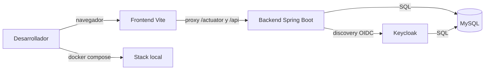
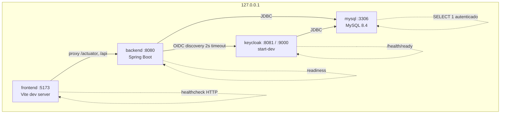
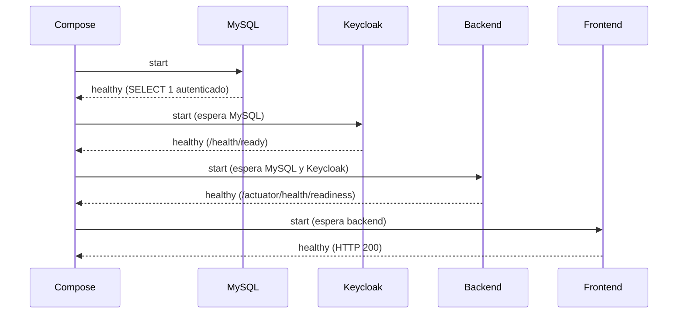
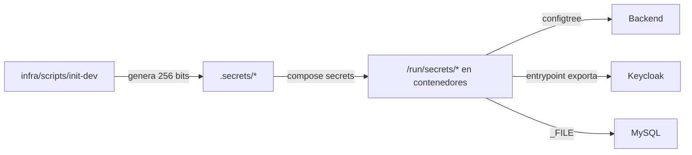

# Arquitectura — Fase 01

Vista de la estructura técnica. No describe módulos funcionales, que aún no existen.

## Contexto

Un solo desarrollador, un solo host. Todo el stack corre en Docker y solo escucha en loopback.

## Contenedores

| Servicio | Responsabilidad | Depende de |
|---|---|---|
| `mysql` | Persistencia de `inventory` y `keycloak`. | — |
| `keycloak` | Realm `inventory-dev` vacío y metadatos OIDC. | `mysql` healthy |
| `backend` | Actuator, readiness con MySQL y discovery OIDC. | `mysql` y `keycloak` healthy |
| `frontend` | Pantalla de estructura y proxy al backend. | `backend` healthy |

## Límites

- **Frontend**: composición en `src/app`, componentes compartidos en `src/components/ui`, utilidades en `src/lib`, tokens en `src/styles`. Los futuros módulos van en `src/features/<nombre>`.
- **Backend**: monolito modular por capacidad bajo `com.veris.inventory`. Paquetes técnicos `config`, `health`, `common/error` y `common/web`; cada módulo de negocio usa `api`, `application`, `domain` e `infrastructure`, con dependencias hacia el dominio. `identity` es el primer módulo.
- **Infraestructura**: `infra/mysql` (inicialización y healthcheck), `infra/keycloak` (entrypoint, healthcheck y realm), `infra/scripts` (preparación y smoke).
- **Documentación**: convenciones, decisiones y verificación en `docs/`.

Regla de dependencia: el frontend habla con el backend solo por HTTP; el backend habla con MySQL por JDBC y con Keycloak solo para discovery. Ningún componente de dominio conoce detalles de infraestructura.

## Arranque y salud

- **Liveness**: solo ciclo de vida del proceso. Una caída de Keycloak no reinicia el backend.
- **Readiness**: estado de aplicación + `db` + `keycloak`. Si falla, el contenedor deja de estar disponible pero no se reinicia.
- **Keycloak**: `/health/ready` en el puerto de management 9000.
- **MySQL**: consulta autenticada a la base `inventory`, no un simple ping.
- **Frontend**: HTTP 200 de Vite; el smoke además valida el proxy.

## Configuración y secretos

- `.env` contiene solo configuración no sensible; `.secrets/` está fuera de Git y de los contextos de build.
- No se pasan secretos como argumentos de build ni se hornean en imágenes.
- `VITE_*` nunca contiene secretos: se envía al navegador.
- En producción se requiere gestor de secretos, TLS y rotación; fuera de esta fase.

## Lo que esta fase no incluye

Inventario, autenticación funcional, autorización, cliente OIDC, usuarios de aplicación, reglas de negocio, firma electrónica, almacenamiento documental y despliegue productivo.
