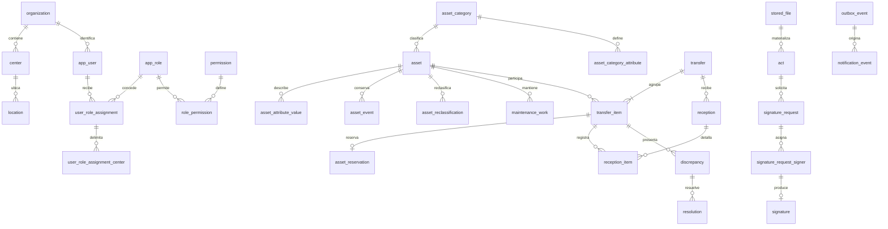

# Esquema MySQL — Fase 02

Fecha: 11 de noviembre de 2026. Alcance: estructura de persistencia, migraciones, mecanismos de integridad y pruebas. No se implementan servicios de negocio, autenticación funcional ni endpoints de inventario.

## Entregables y decisiones

38 tablas de dominio e infraestructura, más `flyway_schema_history`, sobre MySQL Community 8.4 LTS/InnoDB. Se conservan V1–V11 de la estructura existente y se añaden V12–V14 para completar y corregir su integridad. **Excepción documentada:** V5 nunca pudo ejecutarse en MySQL porque `last_value` es una palabra reservada; se renombró a `current_value` antes de su primera aplicación exitosa. No ejecutar `repair` automáticamente sobre instalaciones externas: investigar cualquier diferencia de checksum.

El [diccionario físico](DICCIONARIO-DATOS-FASE-02.md) enumera todas las columnas finales, tipos, nulabilidad, valores predeterminados, claves y relaciones; se genera consultando MySQL después de aplicar las migraciones. Este documento aporta el significado de las tablas y las reglas de uso.

| Migración | Contenido |
|---|---|
| V1 | Organización, centros y ubicaciones. |
| V2 | Usuarios locales sin contraseñas, roles, permisos, alcances y custodios. |
| V3 | Categorías jerárquicas y definiciones de atributos dinámicos. |
| V4 | Metadatos de archivos privados. |
| V5 | Secuencias, activos, QR, valores dinámicos, custodia e historiales. |
| V6 | Traslados, ítems y reserva exclusiva. |
| V7 | Recepciones parciales, discrepancias y resoluciones. |
| V8 | Solicitudes de baja. |
| V9 | Actas, solicitudes de firma, firmantes y evidencia de firma. |
| V10 | Registro mínimo de mantenimiento. |
| V11 | Auditoría, outbox, idempotencia, notificaciones y trabajos. |
| V12 | Banderas derivadas, ubicación física independiente, código estable y leases. |
| V13 | FKs compuestas de organización y correspondencia de ítems/firmantes. |
| V14 | Numeración bloqueada, contadores reconciliados, protección de historial, tipado de atributos y hashes de firma. |

Mantenimiento y reclasificación se incorporan por la solicitud explícita de Fase 02, ampliando el alcance inicialmente pendiente D-02 de Fase 00. Los estados y políticas existentes siguen siendo la línea base técnica; no se consideran resueltos los requisitos legales de firma, retención ni autorización funcional pendientes.

## Diccionario lógico

| Tabla | Significado y relaciones |
|---|---|
| organization | Raíz de aislamiento; nombre, prefijo inicial de códigos y zona horaria de presentación. |
| center | Centro de una organización; código único dentro de ella y estado de actividad. |
| location | Ubicación física de un centro; padre opcional del mismo centro. |
| app_user | Identidad local vinculada a issuer + subject OIDC; correo informativo. No contiene contraseña ni token. |
| app_role | Rol configurable por organización. |
| permission | Capacidad global identificada por código; sin catálogo ficticio insertado. |
| role_permission | Relación N:M entre roles y permisos. |
| user_role_assignment | Asignación de usuario a rol, alcance, vigencia, autor y revocación. |
| user_role_assignment_center | Centros explícitos que componen el alcance de una asignación. |
| custodian | Persona responsable de bienes; vínculo opcional con centro y usuario local. |
| asset_category | Clasificación dinámica organizacional; jerarquía y estado. |
| asset_category_attribute | Atributo de categoría, tipo, obligatoriedad y opciones JSON para listas. |
| stored_file | Clave de objeto, versión, hash, tamaño, tipo, análisis, retención y bloqueo de conservación; no almacena binarios. |
| code_sequence | Contador independiente por organización y propósito, con máximo confirmado. |
| asset | Unidad individual, centro registral, centro/ubicación físicos, categoría, condición, estado y código permanente. |
| asset_qr_identifier | Identificador público aleatorio de 128 bits; unicidad global e historial de rotación. |
| asset_attribute_value | Valor tipado de una definición de la categoría del activo; una columna de valor por fila. |
| asset_custody_assignment | Custodia temporal; una fila abierta por activo y múltiples cerradas. |
| asset_event | Movimiento/hito inmutable con actor, origen, destino, fecha y causa relacionada. |
| asset_reclassification | Historial inmutable de categoría anterior/nueva y cambios de atributos. |
| transfer | Traslado entre dos centros distintos de la misma organización; número, responsables, estado y actas asociadas. |
| transfer_item | Activo incluido una vez en un traslado; instantánea y resultado de recepción/resolución. |
| asset_reservation | Reserva de un ítem concreto; máximo una activa por activo, liberaciones conservadas. |
| reception | Recepción parcial o total de un traslado, receptor y fechas de confirmación/descarte. |
| reception_item | Resultado de un ítem del mismo traslado de la recepción, condición, ubicación/custodio y rechazo. |
| discrepancy | Incidencia de un ítem, responsable, motivo y resolución temporal. |
| resolution | Propuesta/aprobación/ejecución de una solución, con separación entre proponente y aprobador. |
| retirement_request | Solicitud de baja o pérdida y aprobación independiente; evidencia documental vinculada. |
| act | Versión documental con un único origen, instantánea, archivo, hash y vínculo de sustitución. |
| signature_request | Política y hash exactos de un acta emitida; una solicitud activa por acta. |
| signature_request_signer | Usuario esperado y posición de firma dentro de la solicitud. |
| signature | Resultado individual, usuario real, hash firmado y evidencia de identidad/archivo; resultado final inmutable. |
| maintenance_work | Trabajo preventivo/correctivo, planificación, ejecución, responsable y resultado. |
| audit_event | Evento inmutable de acción, actor original/efectivo, alcance, resultado y cambios redactados. |
| outbox_event | Evento de integración guardado en la transacción del hecho; entrega, reintentos, deduplicación y lease. |
| idempotency_key | Clave por organización, actor y operación; huella de petición, respuesta y expiración. |
| notification_event | Notificación por usuario/centro, canal, evento origen y reintentos; no altera inventario. |
| job | Trabajo pendiente con prioridad, payload, lease, intentos, deduplicación y resultado. |

## Relaciones principales

El diagrama expresa relaciones; mínimos entre filas, como exigir al menos un ítem para enviar un traslado, requieren el futuro servicio transaccional. Se permite crear un borrador sin ítems.

## Convenciones de columnas

- `id`: UUID interno en `BINARY(16)`. El predeterminado usa `UUID_TO_BIN(UUID(),1)`; cuando se usen UUID SQL se convierten con `BIN_TO_UUID(id,1)`. Los bytes enviados por la aplicación deben mantener una representación acordada; no mezclar conversiones con y sin intercambio.
- `organization_id`: raíz del registro. Las FKs compuestas impiden enlazar un hijo a otra organización aun con IDs válidos. `permission` es el catálogo global compartido.
- `created_at` / `updated_at`: reloj de base, precisión de microsegundos. La conexión debe usar UTC; `DATETIME` no convierte zonas por sí solo.
- `*_at`: instante de un hecho; `*_state` / `outcome`: vocabulario acotado por CHECK. No representan una autorización a ejecutar transiciones.
- `active_flag` / `open_flag` / `pending_flag` / `executed_flag` / `claimed_flag`: columnas generadas, no escribibles. Son 1 en la condición vigente y NULL fuera de ella. UNIQUE permite conservar múltiples filas históricas.
- `version`: versión optimista que actualizará el servicio futuro con comparación del valor previo.
- `*_snapshot`, `payload`, `attribute_changes`, `identity_evidence`: JSON válido; las reglas de estructura y redacción de datos sensibles pertenecen al futuro contrato funcional.
- `*_hash`: SHA-256 hexadecimal. Se conserva la relación entre contenido del acta, solicitud y firma mediante FKs compuestas.
- `lease_token` / `leased_until`: token opaco y caducidad; una finalización debe comparar el token para impedir que un trabajador atrasado complete un trabajo reasignado.

## Integridad e índices

Todas las tablas son InnoDB; PK por UUID salvo uniones con PK compuesta. Unicidad de código de centro, categoría, rol y número de traslado dentro de organización. El activo tiene UNIQUE `(organization_id, permanent_code_seq)` y UNIQUE `(organization_id, permanent_code)`; los códigos visibles son organizacionales, el QR es globalmente único. La serie de fabricante solo está indexada: no se presume universalmente única.

El prefijo se copia en el activo; cambiar el prefijo organizacional no modifica códigos anteriores. El código visible es generado a partir de prefijo, número de doce dígitos y verificador `98 - MOD(numero * 100,97)`. Un CHECK valida el verificador; triggers impiden cambiar identidad, número/prefijo o eliminar el activo. La baja conserva el código.

Las reservas comprueban simultáneamente traslado, activo e ítem. Las recepciones comprueban que su ítem pertenece al mismo traslado. Las firmas comprueban usuario esperado, solicitud y hash. Centro registral y físico son independientes, pero cada ubicación física debe pertenecer al centro físico y a la misma organización.

Índices orientados a consultas: activos por centro/estado/categoría/serie; traslados por origen/destino y estado; eventos por activo/fecha y auditoría por organización/centro/fecha; colas por estado/próximo intento/prioridad y expiración de lease. MySQL crea además los índices requeridos por FKs. Revisar EXPLAIN y volumen antes de producción; esta fase no acredita rendimiento bajo carga de negocio.

Los triggers protegen contra UPDATE/DELETE de auditoría, movimientos y reclasificaciones; conservan contenido emitido y firmas finales. No protegen contra un DBA que elimine triggers o tablas. La cuenta migradora de desarrollo tiene DDL; producción debe separar cuenta migradora y cuenta operativa sin DDL ni administración de triggers.

## Numeración concurrente

`allocate_code_number(organization_id, sequence_name, OUT numero)` admite `ASSET_PERMANENT_CODE` y `TRANSFER_NUMBER`. Hace upsert de la fila contadora, bloquea con `SELECT ... FOR UPDATE`, comprueba capacidad y aumenta el contador. V14 lo reconcilia con el máximo número existente al migrar datos anteriores.

Contrato obligatorio para el llamador futuro:

1. Abrir transacción explícita (`autocommit=false`).
2. Llamar al procedimiento usando la misma conexión de escritura.
3. Insertar activo/traslado, su evento/auditoría y outbox dentro de esa transacción.
4. Confirmar y solo entonces publicar el código o imprimirlo.
5. Ante error, rollback completo. Ante deadlock/timeout, reintentar toda la transacción con idempotencia y límite de intentos.

El procedimiento no hace COMMIT ni abre una transacción propia. Un número reservado en una transacción abortada no se considera emitido y puede volver a calcularse; un número confirmado no se decrementa ni se reutiliza. Si se necesita reservar/publicar un número antes de crear el activo, deberá confirmarse la reserva en una transacción separada y aceptar huecos. Esa variante no está implementada como servicio.

No se usa `MAX()+1` para asignación ordinaria. Cuando se bloqueen varias secuencias/activos, mantener orden estable para reducir deadlocks. La capacidad se limita a 999999999999.

## Trabajo pendiente y notificaciones

El futuro trabajador reclama lotes con `FOR UPDATE SKIP LOCKED`, asigna token y fecha de expiración y confirma rápido. La acción externa ocurre fuera de esa transacción. Completar/reintentar compara el token y el estado esperado. La expiración permite recuperación tras caída; una clave de deduplicación evita que el mismo evento produzca múltiples consecuencias lógicas. La entrega externa es al menos una vez; estos campos no prometen envío exactamente una vez.

## Límites explícitos

Sin filas de organizaciones, centros, usuarios, roles empresariales o activos ficticios en migraciones. Los datos sintéticos solo se insertan por las pruebas en bases aleatorias `inventory_test_*` y se eliminan al finalizar, salvo conservación explícita para ensayo de respaldo.

Quedan para servicios futuros: permisos efectivos y separación de funciones temporal, cierre de traslado según todos sus ítems/actas, actualización atómica de estado padre/hijos, obligación de atributos y pertenencia a opciones de lista, ausencia de ciclos jerárquicos de profundidad mayor a uno, correspondencia exacta de actas inversas/resoluciones al hecho concreto, y evidencias obligatorias por política. Las FK ya validan existencia, organización y las correspondencias estructurales indicadas; no simulan estos servicios.

Las referencias `owner_entity/owner_id`, `related_entity/related_id` y `aggregate_entity/aggregate_id` son polimórficas y no tienen FK al objeto referenciado. Se preservan como excepciones deliberadas para eventos/archivos; su resolución y autorización requieren validación de aplicación. La protección de los binarios y las firmas legales no se resuelve mediante una tabla.
